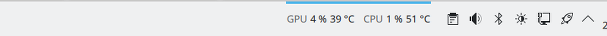

# GPU Monitor – Plasma applet

Shows **GPU utilisation and junction temperature** in the KDE panel — and warns
you with colour before the graphics card gets too hot. **CPU utilisation and
temperature** can be shown as well, with their own warning thresholds.



## Why this exists

Anyone running local LLMs or diffusion models puts sustained load on the GPU.
If the case cannot pull in enough fresh air, heat dissipation eventually falls
behind and the hotspot temperature climbs while the fans are already at full
speed.

The figure most tools show (edge temperature) notices this too late: it sits
roughly 10–15 K below the hotspot. This applet therefore displays the **junction
temperature** and colours it:

| Range | Colour |
| --- | --- |
| below the warning threshold (default 85 °C) | normal text colour |
| at or above the warning threshold | amber |
| at or above the critical threshold (default 100 °C) | red |

Both thresholds are configurable.

## Features

- Utilisation in percent and junction temperature directly in the panel
- Optional CPU utilisation and temperature (hottest core) next to it, switched
  on in the settings
- Colour-coded temperature warnings for GPU and CPU that do **not** rely on
  colour alone: an exclamation mark (`!` warning, `!!` critical) accompanies the
  colour
- Click or keyboard (Tab, then Enter or Space) opens a popup with edge and memory
  temperature, power draw, clock, fan speed and VRAM usage
- Labelled for screen readers: name, role and a spoken description including the
  warning state
- Tooltip with the same values, no click required
- Fixed width, so the panel does not shift while values update
- Pure QML: no dependencies, no build step, no background service
- Translated into 38 languages; adding another is a single `.po` file

## Installation

```bash
git clone https://github.com/Stecker1312/plasma-gpu-monitor.git
cd plasma-gpu-monitor
./install.sh
systemctl --user restart plasma-plasmashell.service
```

Then right-click the panel → *Add Widgets* → **GPU Monitor**.

`install.sh` only creates a symlink:

```
~/.local/share/plasma/plasmoids/org.stecker.gpumonitor -> <repo>/package
```

This keeps the repository version and the running version identical.

To uninstall:

```bash
rm ~/.local/share/plasma/plasmoids/org.stecker.gpumonitor
```

## Configuration

Right-click the widget → **Configure GPU Monitor**

- GPU warning threshold in °C (default 85)
- GPU critical threshold in °C (default 100)
- show or hide the utilisation figure in the panel
- show or hide the CPU values (utilisation and temperature) in the panel (default off)
- CPU warning and critical thresholds in °C (default 80 and 90)

The GPU thresholds refer to the junction temperature. AMD specifies 110 °C as
the maximum for Navi 31 (RX 7900 XT/XTX), so the red stage at 100 °C still
leaves some headroom. The CPU value is the hottest core; Ryzen 5000 throttles at
90 °C, hence the lower default thresholds. Both CPU thresholds are configurable.

## Compatibility

| | |
| --- | --- |
| Tested with | Bazzite, Plasma 6.7.5, Wayland |
| GPU | AMD Radeon RX 7900 XTX (Navi 31), `amdgpu` |
| Requirement | Plasma 6, `ksystemstats` with the GPU plugin (CPU plugin for the optional CPU temperature) |

Other AMD cards using `amdgpu` should work as long as `ksystemstats` exposes them
as `gpu/gpu0`. NVIDIA is untested.

Check which sensors are available:

```bash
busctl --user call org.kde.ksystemstats1 /org/kde/ksystemstats1 \
  org.kde.ksystemstats1 allSensors --json=short | grep -oE '"(gpu|cpu)/[^"]*"'
```

## Limitations

- single GPU only (`gpu/gpu0`)
- no history graphs, current values only
- no NVIDIA support (untested)
- the CPU value is the hottest core (`cpu/all/maximumTemperature`), not a
  per-core breakdown

## Accessibility

Deliberately not an afterthought, because a temperature warning is useless if it
only works for people who can see colour or use a mouse:

- **Not colour-only.** Above the warning threshold the value gains `!`, above the
  critical threshold `!!`. Colour perception is not required to notice the state.
- **Screen reader support.** The panel item exposes itself as a button named
  "GPU" (or "GPU / CPU" when the CPU values are shown) with a description
  like "Utilisation: 12 %, Junction (Hotspot): 92 °C, Warning". The state word is
  included because colour and `!` are visual.
- **Keyboard accessible.** The item is focusable with Tab and opens with Enter or
  Space, with a visible focus ring. Mouse is optional.

Checking it without permanently enabling a screen reader:

```bash
systemctl --user set-environment QT_LINUX_ACCESSIBILITY_ALWAYS_ON=1
systemctl --user restart plasma-plasmashell.service
python3 -c 'import pyatspi; print([a.name for a in pyatspi.Registry.getDesktop(0)])'
# afterwards:
systemctl --user unset-environment QT_LINUX_ACCESSIBILITY_ALWAYS_ON
systemctl --user restart plasma-plasmashell.service
```

## Languages

Source strings are English. Translations are ordinary gettext catalogues in `po/`.

```bash
./translate.sh            # compile po/*.po and install them for the current user
./translate.sh --extract  # refresh the template from the QML sources
```

Bundled: 38 translations — Albanian, Arabic, Bosnian, Bulgarian, Catalan,
Chinese (Simplified), Croatian, Czech, Danish, Dutch, Estonian, Finnish, French,
German, Greek, Hindi, Hungarian, Icelandic, Indonesian, Italian, Japanese,
Korean, Latvian, Lithuanian, Macedonian, Norwegian Bokmål, Polish, Portuguese,
Romanian, Russian, Serbian, Slovak, Slovenian, Spanish, Swedish, Turkish,
Ukrainian, Vietnamese. The applet name and description in Plasma's widget list
are translated as well, through localised keys in `package/metadata.json`.

Honest note on coverage: the smaller European languages add only about 100
million first-language speakers, so they hardly move the global percentage —
together with the large languages this is roughly 40 % of the world as a first
language. They are here because KDE's user base is disproportionately European,
which is where a translation actually gets seen. Reaching 99 % of the world
would take several hundred of its 7,000 languages: far out of proportion for 16
strings. Languages with large speaker counts that are **not** included (Bengali,
Urdu, Punjabi, Telugu, Marathi, Tamil, Thai, Javanese, Swahili, Hausa, Amharic,
Filipino, Persian, Cantonese, Wu) are missing deliberately: a bad translation is
worse than an English fallback. Native speakers are welcome to add them.

To add a language: copy `po/plasma_applet_gpumonitor.pot` to
`po/<lang>.po`, translate the `msgstr` entries, run `./translate.sh` and restart
Plasma. No build system, no recompilation of the source strings.

The catalogue name matters: Plasma uses `plasma_applet_<applet id>` as its
translation domain, so the compiled file has to be
`plasma_applet_org.stecker.gpumonitor.mo`. `translate.sh` takes care of that.

## Development

Technical documentation for maintenance and troubleshooting lives in
[AGENTS.md](AGENTS.md) — sensor IDs, known pitfalls and a test routine to run
before every commit.

In short: edit files under `package/`, run `./check.sh`, restart Plasma, check,
commit.

```bash
./check.sh
systemctl --user restart plasma-plasmashell.service
journalctl --user --since "-1min" --no-pager | grep -iE 'qml.*error|Unable to assign'
```

> This project is not maintained by hand on a regular basis; it is developed with
> AI assistance when needed. It is deliberately kept small: no dependencies, no
> architecture that demands attention.

## Licence

MIT – see [LICENSE](LICENSE).
