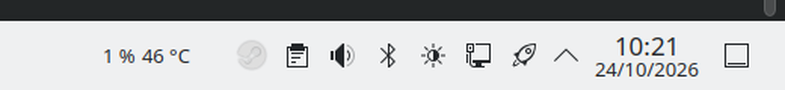

# GPU Monitor – Plasma applet

Shows **GPU utilisation and junction temperature** in the KDE panel — and warns
you with colour before the graphics card gets too hot.



## Why this exists

Anyone running local LLMs or diffusion models puts sustained load on the GPU.
If the case cannot pull in enough fresh air, heat dissipation eventually falls
behind and the hotspot temperature climbs while the fans are already at full
speed.

The figure most tools show (edge temperature) notices this too late: it sits
roughly 10–15 K below the hotspot. This applet therefore displays the **junction
temperature** and colours it:

| Range | Colour |
| --- | --- |
| below the warning threshold (default 85 °C) | normal text colour |
| at or above the warning threshold | amber |
| at or above the critical threshold (default 100 °C) | red |

Both thresholds are configurable.

## Features

- Utilisation in percent and junction temperature directly in the panel
- Colour-coded temperature warning
- Clicking opens a popup with edge and memory temperature, power draw and VRAM
  usage
- Tooltip with the same values, no click required
- Fixed width, so the panel does not shift while values update
- Pure QML: no dependencies, no build step, no background service

## Installation

```bash
git clone https://github.com/Stecker1312/plasma-gpu-monitor.git
cd plasma-gpu-monitor
./install.sh
systemctl --user restart plasma-plasmashell.service
```

Then right-click the panel → *Add Widgets* → **GPU Monitor**.

`install.sh` only creates a symlink:

```
~/.local/share/plasma/plasmoids/org.stecker.gpumonitor -> <repo>/package
```

This keeps the repository version and the running version identical.

To uninstall:

```bash
rm ~/.local/share/plasma/plasmoids/org.stecker.gpumonitor
```

## Configuration

Right-click the widget → **Configure GPU Monitor**

- warning threshold in °C (default 85)
- critical threshold in °C (default 100)
- show or hide the utilisation figure in the panel

The thresholds refer to the junction temperature. AMD specifies 110 °C as the
maximum for Navi 31 (RX 7900 XT/XTX), so the red stage at 100 °C still leaves
some headroom.

## Compatibility

| | |
| --- | --- |
| Tested with | Bazzite, Plasma 6.7.5, Wayland |
| GPU | AMD Radeon RX 7900 XTX (Navi 31), `amdgpu` |
| Requirement | Plasma 6, `ksystemstats` with the GPU plugin |

Other AMD cards using `amdgpu` should work as long as `ksystemstats` exposes them
as `gpu/gpu0`. NVIDIA is untested.

Check which sensors are available:

```bash
busctl --user call org.kde.ksystemstats1 /org/kde/ksystemstats1 \
  org.kde.ksystemstats1 allSensors --json=short | grep -o '"gpu/[^"]*"'
```

## Limitations

- single GPU only (`gpu/gpu0`)
- no history graphs, current values only
- no NVIDIA support (untested)

## Development

Technical documentation for maintenance and troubleshooting lives in
[AGENTS.md](AGENTS.md) — sensor IDs, known pitfalls and a test routine to run
before every commit.

In short: edit files under `package/`, restart Plasma, check, commit.

```bash
systemctl --user restart plasma-plasmashell.service
journalctl --user --since "-1min" --no-pager | grep -iE 'qml.*error|Unable to assign'
```

> This project is not maintained by hand on a regular basis; it is developed with
> AI assistance when needed. It is deliberately kept small: no dependencies, no
> architecture that demands attention.

## Licence

MIT – see [LICENSE](LICENSE).
